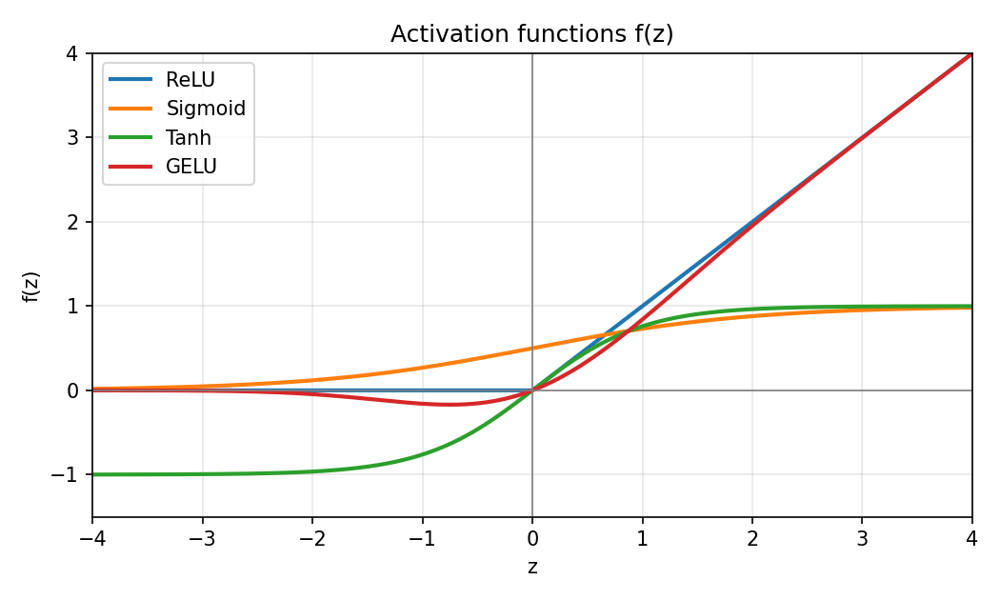
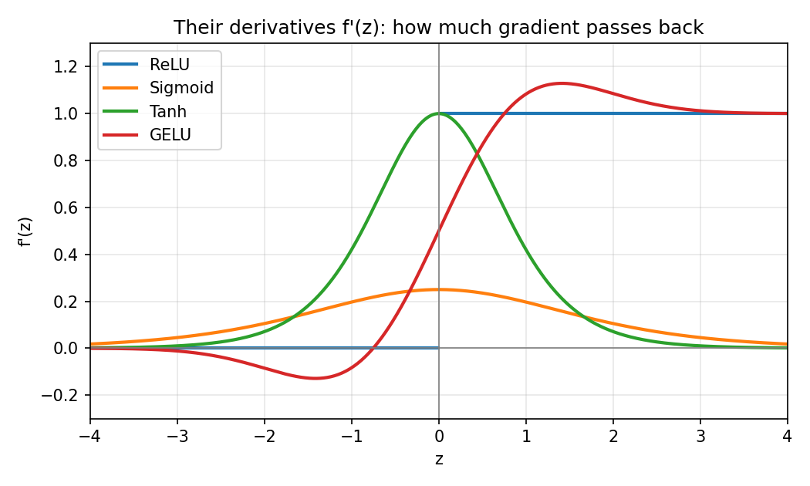
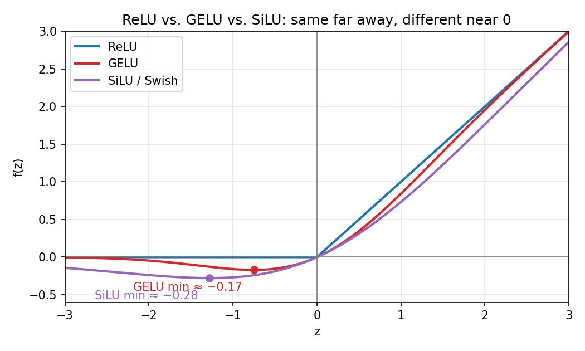

# Activation Functions: A Practical Guide

Neural networks typically apply a non-linear **activation function** between their hidden linear layers; the final output layer often uses a different activation, or none at all, depending on the task. Activations are easy to treat as magic. This guide builds the intuition first (what an activation does, and how it affects gradients during training), then walks through the major activation functions and their important variants: what they do, why they exist, where they're used, and how to compute them correctly.

Code examples use NumPy. The exact GELU (§7.2) also needs SciPy for `erf`; everything else is NumPy-only. Unfamiliar terms are defined in the [Glossary](#glossary).

```python
import numpy as np
```

---

## Contents

1. [Why activation functions exist](#1-why-activation-functions-exist)
2. [Forward and backward passes](#2-forward-and-backward-passes)
3. [Five fundamental functions](#3-five-fundamental-functions): ReLU, Sigmoid, Tanh, GELU, Softmax on one shared example
4. [Derivatives and vanishing gradients](#4-derivatives-and-vanishing-gradients)
5. [Classic functions](#5-classic-functions): Identity, Step, Sigmoid, Tanh
6. [The ReLU family](#6-the-relu-family): ReLU, Leaky ReLU, PReLU, RReLU, ReLU6, ELU, SELU, CELU
7. [Smooth modern functions](#7-smooth-modern-functions): Softplus, GELU, Swish / SiLU, Mish
8. [Cheap approximations](#8-cheap-approximations): Hard Sigmoid, Hard Tanh, Hard Swish, Softsign
9. [Output-layer functions](#9-output-layer-functions): Softmax, Log-Softmax, Sparsemax
10. [Gated and learned activation mechanisms](#10-gated-and-learned-activation-mechanisms): GLU, SwiGLU, GeGLU, Maxout
11. [Putting it together: an MLP forward pass](#11-putting-it-together-an-mlp-forward-pass)
12. [Comparison tables](#12-comparison-tables)
13. [Choosing an activation](#13-choosing-an-activation)
- [Glossary](#glossary)

---

## 1. Why activation functions exist

A layer in an MLP computes a linear transformation:

```
z = W·x + b
```

If you stack layers with nothing between them:

```
W2·(W1·x + b1) + b2  =  (W2·W1)·x + (W2·b1 + b2)  =  W'·x + b'
```

The whole stack collapses to **a single linear (affine) layer**: however many linear layers you stack, their composition is still one affine transformation. A classifier built only from them can therefore draw only linear decision boundaries (hyperplanes), no matter how deep it is.

An activation function `f` is applied after each linear step:

```
h = f(W·x + b)
```

Because `f` is **non-linear**, the layers no longer collapse, and the network can model curved, complex relationships. This is what makes depth useful.

Activations play two different roles in an MLP:

| Where | Purpose | Typical choices |
|---|---|---|
| Hidden layers | Add non-linearity so depth matters | ReLU, GELU, SiLU, Leaky ReLU |
| Output layer | Turn raw scores into a usable answer | Sigmoid, Softmax, or nothing (regression) |

### Properties worth knowing

When comparing activations, these properties come up repeatedly:

- **Range**: bounded (e.g. sigmoid, 0–1) or unbounded (e.g. ReLU, 0–∞).
- **Zero-centered**: whether the function's output range extends to both sides of 0 and is symmetric around 0 (tanh is; sigmoid and Leaky ReLU aren't). In this guide it describes the function's shape, not the actual mean of its outputs, which depends on the input distribution. (The term is also sometimes used for that statistical mean.) Zero-centered activations tend to make optimization easier.
- **Monotonic**: whether the function never decreases as its input increases (ReLU counts, even though it's flat for negative inputs). Modern smooth functions (GELU, Swish, Mish) are *not* monotonic — they dip slightly below 0 for small negative inputs.
- **Smoothness**: whether the derivative is continuous. ReLU has a kink at 0; GELU and Swish are smooth everywhere.
- **Saturation**: whether the gradient approaches 0 for large inputs. Saturating functions (sigmoid, tanh) cause **vanishing gradients** in deep networks (explained in §4).
- **Cost**: element-wise comparisons are cheap; exponentials and `erf` are more expensive, which matters on mobile and embedded hardware.

> **Inference vs. training.** Many of these trade-offs (vanishing gradients, dead neurons) affect *training*. At inference time the weights are fixed, and you simply apply whatever function the model was trained with. Using a different activation at inference than at training time will break the model.

---

## 2. Forward and backward passes

A network is used in two directions, and an activation plays a different role in each.

**Forward pass (inference and training).** Data flows from input to output. At each layer, the activation transforms the value:

```
z = W·x + b      # linear step
h = f(z)         # activation
```

**Backward pass (training only).** After the loss is computed, gradients flow from the output back toward the input so every weight learns which way to move (see [backpropagation.md](backpropagation.md) and [chain_rule.md](chain_rule.md)). Each activation passes the gradient along, multiplied by its **derivative** at the value it saw on the forward pass:

```
gradient into z  =  f'(z) × gradient arriving at h
```

The derivative acts like a valve on the gradient:

| f'(z) | Effect on the gradient |
|---|---|
| ≈ 1 | Passes through unchanged |
| between 0 and 1 | Shrinks |
| exactly 0 | Blocked: nothing upstream learns from this example through this unit |

This one idea explains most of the history of activation functions. Sigmoid and tanh fell out of favor for hidden layers because their derivatives are small (§4). ReLU took over because its derivative is exactly 1 for positive inputs. Several ReLU variants address its zero derivative for negative inputs; others add bounded outputs, smoother negative regions or different training properties.

> **Inference only needs the forward pass.** If you're only running a trained model, derivatives never appear in your code, but they explain *why* the model was built with the activation it has.

---

## 3. Five fundamental functions

There are dozens of activations, but most are variations on five ideas. Learn these first; everything later in the guide is a refinement.

| Function | What it does | Main use |
|---|---|---|
| **ReLU** | Negative inputs become 0; positive inputs pass through unchanged | Default for hidden layers |
| **Sigmoid** | Squashes any number into (0, 1) | Probabilities, gates |
| **Tanh** | Squashes any number into (−1, 1), centered on 0 | RNNs, bounded outputs |
| **GELU** | Like ReLU, but fades negative inputs out smoothly instead of cutting them off | Transformers |
| **Softmax** | Turns a *vector* of scores into probabilities that sum to 1 | Multi-class outputs, attention |

### Same input, five functions

Feed the same five values through each:

```python
z = np.array([-2.0, -1.0, 0.0, 1.0, 2.0])
```

| z | −2 | −1 | 0 | 1 | 2 |
|---|---|---|---|---|---|
| `relu(z)` | 0 | 0 | 0 | 1 | 2 |
| `sigmoid(z)` | 0.119 | 0.269 | 0.5 | 0.731 | 0.881 |
| `tanh(z)` | −0.964 | −0.762 | 0 | 0.762 | 0.964 |
| `gelu(z)` | −0.046 | −0.159 | 0 | 0.841 | 1.954 |
| `softmax(z)` | 0.012 | 0.032 | 0.086 | 0.234 | 0.636 |



*(Plots in this guide are generated by [`images/make_activation_plots.py`](images/make_activation_plots.py).)*

What to notice:

- **ReLU** throws away all negative information: −2 and −1 both become 0.
- **Sigmoid** keeps the order but compresses everything into (0, 1). Zero maps to 0.5, and outputs are never negative.
- **Tanh** has the same S-shape but is centered on 0, so negative inputs stay negative.
- **GELU** is close to ReLU for positive values (2 → 1.954) but lets small negatives through as small negatives (−1 → −0.159) instead of zeroing them.
- **Softmax** is the odd one out: each output depends on *all* inputs. It rescales the whole vector to sum to 1, and the largest input (2) takes most of the probability (0.636).

The first four are **element-wise** (each output depends only on its own input); softmax is not.

Softmax is also the heart of transformer **attention**: each token's raw attention scores go through softmax, and the resulting weights (which sum to 1) decide how much each token contributes to the weighted sum of values. See [attention_blocks.md](attention_blocks.md).

### Which one for which job?

A first mental map before meeting all the variants (§13 has the full guide):

| What you need | Reach for |
|---|---|
| Remove negative values; a cheap default for hidden layers | ReLU |
| Keep some negative information | Leaky ReLU (§6.2) |
| Smooth, ReLU-like behavior | GELU / SiLU (§7) |
| One probability between 0 and 1 | Sigmoid |
| Probabilities over N classes that sum to 1 | Softmax |
| Let one signal control how much of another passes through | Gating: GLU / SwiGLU (§10) |

### Map of the families

```
Classic ─────────── Identity, Step, Sigmoid, Tanh
                       (historical; sigmoid/tanh still used in gates & outputs)

ReLU family ─────── ReLU → Leaky ReLU, PReLU, RReLU, ReLU6
                       → ELU, SELU, CELU   (smooth negative side)

Smooth modern ───── Softplus, GELU, Swish/SiLU, Mish
                       (common in transformers and some modern CNN architectures)

Cheap functions & approximations ─ Hard Sigmoid, Hard Tanh, Hard Swish, Softsign
                       (cheap versions for mobile / quantized models)

Output ──────────── Softmax, Log-Softmax, Sparsemax

Gated / learned ─── GLU, SwiGLU, GeGLU, Maxout
                       (used in modern LLM feed-forward blocks)
```

Sections 5–10 cover each family in detail.

---

## 4. Derivatives and vanishing gradients

Before exploring the individual families, one question matters most: what happens to the gradient when it passes through an activation?

The derivative `f'(z)` is the slope of the activation at `z`: how much the output changes when the input changes a little. From §2, it is also the factor that multiplies the gradient on its way back through the activation.

### Derivatives of the fundamentals

| Function | Derivative | Largest value |
|---|---|---|
| ReLU | 1 if z > 0; 0 if z < 0; undefined at z = 0 (see `*` below) | 1 |
| Sigmoid | σ(z)·(1 − σ(z)) | 0.25 (at z = 0) |
| Tanh | 1 − tanh²(z) | 1 (at z = 0) |
| GELU | Φ(z) + z·φ(z) | ≈ 1.13 (at z ≈ 1.41) |

(Φ and φ are the standard normal CDF and density. Softmax is different because it isn't element-wise; see [Softmax: a matrix of derivatives](#softmax-a-matrix-of-derivatives) below.)

On the shared example from §3:

| z | −2 | −1 | 0 | 1 | 2 |
|---|---|---|---|---|---|
| ReLU′ | 0 | 0 | 0* | 1 | 1 |
| sigmoid′ | 0.105 | 0.197 | 0.25 | 0.197 | 0.105 |
| tanh′ | 0.071 | 0.420 | 1 | 0.420 | 0.071 |
| GELU′ | −0.085 | −0.083 | 0.5 | 1.083 | 1.085 |

`*` ReLU has a kink at 0 and no true derivative there; any value between 0 and 1 is a valid *subgradient*. Frameworks just pick one (usually 0). That choice is a convention of automatic differentiation, not a mathematically unique derivative, and it makes no practical difference.



Read this plot as "how much gradient gets through." Sigmoid never passes more than a quarter. Sigmoid and tanh both fall toward 0 at the edges: that's saturation. ReLU is a hard switch, 0 or 1. GELU lets a small gradient through over most of the negative side instead of none (it crosses 0 at z ≈ −0.75 and is slightly negative to the left of that).

### Vanishing gradients

A gradient travelling back through *n* layers is multiplied by one activation derivative per layer (along with the weights). If each factor is small, the product shrinks exponentially:

```
sigmoid, best case, 10 layers:   0.25^10  ≈ 0.00000095
ReLU, active units, 10 layers:   1^10     = 1
```

Early layers then receive almost no gradient and barely learn. This is the **vanishing gradient problem**, and it's why sigmoid and tanh are avoided in deep hidden stacks. **Saturation** is the cause: where the curve flattens out (large |z|), the derivative is near 0 and the gradient is effectively blocked.

ReLU's derivative is exactly 1 for every positive input, so active units don't scale the gradient at all. A derivative of 1 means the activation doesn't shrink the gradient; it doesn't guarantee the gradient survives the whole layer (see the weight matrix below). That is the main reason it replaced sigmoid and tanh.

This doesn't make deep ReLU networks immune, though. The backward pass also multiplies by each layer's **weight matrix**, and weights that are too small or too large can still make gradients vanish or explode. ReLU only removes the activation's own contribution to the shrinking, which is why the activation and the weight initialization are chosen together (see below).

For one layer `h = f(W·x + b)` with `z = W·x + b`, the full backward step makes this explicit:

```
∂L/∂z = f'(z) ⊙ ∂L/∂h      # the activation's valve (element-wise)
∂L/∂x = Wᵀ · ∂L/∂z         # then the weight matrix
```

The activation contributes only the `f'(z)` factor. `Wᵀ` is applied at every layer as well, and it can shrink or amplify the gradient whichever activation you use.

### Dying ReLU

The flip side: ReLU's derivative is exactly 0 for negative inputs. If a unit's input is negative for every training example, it outputs 0, passes back zero gradient, and its weights never change again; the unit is **dead**. Leaky ReLU keeps a constant non-zero slope for negative inputs. ELU's slope is also non-zero for every finite negative input, but it shrinks exponentially, so for large negative inputs it is effectively 0 in floating point. GELU and SiLU keep small negative outputs and let gradient through over most of the negative region, but their slope is exactly 0 at their minimum (z ≈ −0.75 for GELU, ≈ −1.28 for SiLU) and fades toward 0 for very negative inputs. Because they are non-monotonic, their slope is even slightly *negative* to the left of that minimum, so locally they reverse the sign of the gradient instead of just shrinking it. All of these reduce the risk of permanently dead units, but none guarantees that a unit will recover (§6, §7).

### Softmax: a matrix of derivatives

Because every softmax output depends on every input, its derivative isn't one number per element but a matrix, the **Jacobian**:

```
∂s_i/∂z_j = s_i·(1 − s_i)    if i = j
          = −s_i·s_j         if i ≠ j

In matrix form:  J = diag(s) − s·sᵀ
```

Raising one logit raises its own probability and lowers all the others, which is why the off-diagonal terms are negative. In practice softmax is paired with cross-entropy, and the combined gradient with respect to the logits simplifies to `s − y` (predicted minus true probabilities); see [cross_entropy.md](cross_entropy.md).

### Activations and weight initialization

How weights are initialized decides whether activations and gradients keep a sensible scale as they pass through many layers, and the right scale depends on the activation:

| Activation | Usual initialization | Typical weight variance (normal initialization) |
|---|---|---|
| ReLU and its variants | He (Kaiming) | 2 / fan_in |
| SELU | LeCun normal | 1 / fan_in |
| Tanh, sigmoid | Xavier (Glorot) | 2 / (fan_in + fan_out) |

`fan_in` is the number of inputs to a layer (`fan_out`, the number of outputs). Assuming pre-activations are roughly symmetric around 0, ReLU zeroes about half of them, which halves the signal's variance; He initialization uses twice the variance of LeCun initialization (2 / fan_in instead of 1 / fan_in) to compensate. Getting this pairing right keeps signals from shrinking or blowing up at the start of training.

---

## 5. Classic functions

### 5.1 Identity (Linear)

```
f(z) = z
```

No transformation at all. Used on the **output layer of regression models**, where the network should be able to produce any real number. Using it in hidden layers makes them collapse (see §1).

```python
def identity(z):
    return z
```

### 5.2 Binary Step (Heaviside)

```
f(z) = 1 if z ≥ 0 else 0
```

The activation of the original perceptron (1958). Its derivative is 0 wherever it is defined (it's undefined at 0), so it **cannot be trained directly with ordinary gradient descent**. Today it's of historical and teaching interest only.

```python
def step(z):
    return (np.asarray(z) >= 0).astype(float)
```

### 5.3 Sigmoid (Logistic)

```
sigmoid(z) = 1 / (1 + e^(-z))
```

Squashes any real number into **(0, 1)**.

```
  1.0 |              ________
      |           /
  0.5 |---------•
      |       /
  0.0 |______/
      +------------------------
           -6    0    +6
```

| z | -∞ | -2 | 0 | 2 | +∞ |
|---|---|---|---|---|---|
| sigmoid(z) | → 0 | 0.119 | 0.5 | 0.881 | → 1 |

**Where it's used**

- **Binary classification output**: one neuron gives P(positive class). Predict "yes" if ≥ 0.5 (equivalently, if `z ≥ 0`).
- **Multi-label output**: several independent yes/no outputs; probabilities don't need to sum to 1.
- **Gates** in LSTMs, GRUs, and Swish/GLU, where a 0–1 "how much to let through" value is needed.

**Why not in hidden layers**: the slope is at most 0.25 and near 0 for large |z|, so gradients **vanish** through deep stacks. Outputs are also always positive (not zero-centered).

**Numerically stable version** (avoids overflow of `e^(-z)` for large negative z):

```python
def sigmoid(z):
    z = np.asarray(z, dtype=float)
    out = np.empty_like(z)
    pos = z >= 0
    out[pos] = 1 / (1 + np.exp(-z[pos]))
    ez = np.exp(z[~pos])              # safe: z is negative here
    out[~pos] = ez / (1 + ez)
    return out
```

### 5.4 Tanh (Hyperbolic Tangent)

```
tanh(z) = (e^z - e^(-z)) / (e^z + e^(-z))  =  2·sigmoid(2z) - 1
```

A rescaled sigmoid with range **(-1, 1)**.

| z | -∞ | -2 | 0 | 2 | +∞ |
|---|---|---|---|---|---|
| tanh(z) | → -1 | -0.964 | 0 | 0.964 | → 1 |

- **Zero-centered**, which made it preferable to sigmoid for hidden layers before ReLU.
- Steeper than sigmoid (max slope 1 vs 0.25) but still **saturates**, so gradients still vanish in deep networks.
- Still common in **vanilla RNN state updates** and in **LSTM/GRU candidate-state and hidden-state transformations**, and when outputs must lie in [-1, 1] (e.g. image generators producing normalized pixels, or reinforcement-learning action outputs).

```python
def tanh(z):
    return np.tanh(z)
```

---

## 6. The ReLU family

### 6.1 ReLU (Rectified Linear Unit)

```
ReLU(z) = max(0, z)
```

```
  output
    |        /
    |       /
    |      /
----+-----/-------- input
    |    0
```

```
z       = [-2.0, -0.5, 0.0, 1.5, 3.0]
ReLU(z) = [ 0.0,  0.0, 0.0, 1.5, 3.0]
```

**Why it became the default (≈2011 onward)**

- **Cheap**: one comparison, no exponentials.
- **Non-saturating** for positive inputs: slope is exactly 1, so the activation itself doesn't shrink gradients through many layers (the weights still can; see §4).
- **Sparse**: many neurons output exactly 0. That reduces how much non-zero information flows forward, and systems built for sparse computation can exploit it; ordinary dense hardware (CPUs, GPUs) doesn't run faster just because some values are zero.
- Despite its simplicity, a sufficiently wide or deep network of ReLUs can approximate any continuous function on a bounded (compact) domain, using piecewise-linear pieces.

**Weakness — "dying ReLU"**: if a neuron's input becomes negative for every example, it outputs 0, its gradient is 0, and it never recovers during training. Several of the variants below address this (Leaky ReLU, PReLU, RReLU, ELU); others serve different goals, such as bounded outputs (ReLU6) or self-normalization (SELU).

```python
def relu(z):
    return np.maximum(0, z)
```

### 6.2 Leaky ReLU

```
LeakyReLU(z) = z        if z > 0
             = α·z      otherwise      (α typically 0.01)
```

A small, non-zero slope on the negative side lets gradients keep flowing even for negative inputs, reducing the risk of permanently inactive neurons. Common in GANs (often with α = 0.2).

```python
def leaky_relu(z, alpha=0.01):
    return np.where(z > 0, z, alpha * z)
```

### 6.3 PReLU (Parametric ReLU)

Same formula as Leaky ReLU, but **α is learned** during training (one per channel, or one shared). At inference, α is just a stored weight.

```python
def prelu(z, alpha):        # alpha loaded from the trained model
    return np.where(z > 0, z, alpha * z)
```

### 6.4 RReLU (Randomized Leaky ReLU)

During **training**, α is sampled randomly from a range (e.g. [1/8, 1/3]) for each element, acting as a regularizer. During **inference**, α is fixed to the average of that range:

```python
def rrelu_inference(z, lower=1/8, upper=1/3):
    alpha = (lower + upper) / 2
    return np.where(z > 0, z, alpha * z)
```

This is a good example of an activation that behaves *differently* at training and inference time.

### 6.5 ReLU6

```
ReLU6(z) = min(max(0, z), 6)
```

ReLU capped at 6. Popularized by **MobileNet**: the bounded range works well with low-precision (8-bit) quantized inference on mobile hardware.

```python
def relu6(z):
    return np.clip(z, 0, 6)
```

### 6.6 ELU (Exponential Linear Unit)

```
ELU(z) = z                  if z > 0
       = α·(e^z - 1)        otherwise      (α typically 1.0)
```

- Smooth negative side that saturates at **-α**.
- Negative outputs can move mean activations closer to 0, which can speed up learning.
- Costs an exponential for negative inputs.

```python
def elu(z, alpha=1.0):
    return np.where(z > 0, z, alpha * np.expm1(np.minimum(z, 0)))
```

(`expm1` computes `e^z - 1` accurately for small z; `np.minimum(z, 0)` avoids overflow in the unused branch.)

### 6.7 SELU (Scaled ELU)

```
SELU(z) = λ · ELU(z, α)

λ ≈ 1.0507
α ≈ 1.67326
```

These constants are designed to make the network **self-normalizing**: the mean and variance of activations tend toward 0 and 1 across layers, without batch normalization. This is not guaranteed for arbitrary networks; it relies on specific conditions (LeCun-normal weight initialization, plain fully-connected layers, roughly standardized inputs, "alpha dropout" instead of regular dropout, because alpha dropout is designed to preserve the mean and variance of activations under SELU's self-normalizing assumptions, whereas ordinary dropout can disturb them). Designed specifically for **deep MLPs**. Even then, self-normalization is an approximate statistical tendency, not a guarantee that every layer has exactly mean 0 and variance 1.

Unlike ELU with α = 1, SELU is **not smooth** at 0: its slope is λ ≈ 1.05 just right of zero but λ·α ≈ 1.76 just left of it, so the derivative jumps.

```python
def selu(z):
    lam, alpha = 1.0507009873554805, 1.6732632423543772
    return lam * np.where(z > 0, z, alpha * np.expm1(np.minimum(z, 0)))
```

### 6.8 CELU (Continuously Differentiable ELU)

```
CELU(z) = max(0, z) + min(0, α·(e^(z/α) - 1))
```

A reformulation of ELU (requires α > 0) whose derivative is continuous for every such α (ELU's is only continuous when α = 1). Identical to ELU when α = 1.

```python
def celu(z, alpha=1.0):
    return np.maximum(0, z) + np.minimum(0, alpha * np.expm1(np.minimum(z, 0) / alpha))
```

---

## 7. Smooth modern functions

GELU and SiLU (and the related Mish) are common in **transformers** and recent CNNs: they look like ReLU for large inputs but are smooth around 0 and let small negative values through. Softplus, also covered here, is a smooth ReLU that stays strictly positive; it's mainly used when an output must be positive.

```
        ReLU                GELU / Swish / Mish
         |   /                    |   /
         |  /                     |  /
  _______|_/          ____     ___|_/
         0                \__/    0
                      (slight dip below zero)
```



Far from 0 the three are nearly identical. Near 0 they differ: GELU and SiLU bend smoothly, dip slightly below 0 (GELU to about −0.17 near z = −0.75, SiLU to about −0.28 near z = −1.28) and let small negative values through, while ReLU cuts off sharply. Those differences change what a trained model has learned, so they are not interchangeable with ReLU, or with each other, at inference time.

### 7.1 Softplus

```
Softplus(z) = ln(1 + e^z)
```

A smooth version of ReLU: always positive, approaches `z` for large z and 0 for very negative z. Its derivative is exactly the sigmoid. Commonly used when a network must output a **strictly positive value** (e.g. a variance or standard deviation), and as a building block for Mish. In floating point it can underflow to exactly 0 for very negative inputs (below about −745 in float64, −103 in float32), so code that divides by it or takes its log usually adds a small constant, e.g. `softplus(z) + 1e-6`.

```python
def softplus(z):
    return np.logaddexp(0, z)     # = ln(e^0 + e^z), numerically stable
```

### 7.2 GELU (Gaussian Error Linear Unit)

```
GELU(z) = z · Φ(z)
```

where `Φ` is the cumulative distribution function of the standard normal distribution. Intuitively, the input is scaled by "the probability that a standard normal value is below it" — large positive inputs pass almost fully, large negative ones are nearly zeroed, and values near 0 are smoothly weighted. This is a deterministic calculation; no random sampling takes place.

**Widely used in BERT, GPT-2/GPT-3 and Vision Transformers.** Many newer LLMs (LLaMA, Mistral, PaLM) use SwiGLU instead (§10.2).

Exact form uses the error function:

```
GELU(z) = 0.5 · z · (1 + erf(z / √2))
```

A widely used fast approximation:

```
GELU(z) ≈ 0.5 · z · (1 + tanh( √(2/π) · (z + 0.044715 · z³) ))
```

> Use the same variant the model was trained with — exact and tanh-approximated GELU give slightly different numbers.

The exact version below needs **SciPy** for `erf` (`pip install scipy`); `gelu_tanh` uses NumPy only.

```python
from math import sqrt, pi
from scipy.special import erf

def gelu(z):
    return 0.5 * z * (1 + erf(z / sqrt(2)))

def gelu_tanh(z):
    return 0.5 * z * (1 + np.tanh(sqrt(2 / pi) * (z + 0.044715 * z**3)))
```

### 7.3 Swish / SiLU (Sigmoid Linear Unit)

```
Swish(z) = z · sigmoid(β·z)
SiLU(z)  = z · sigmoid(z)          (Swish with β = 1)
```

Discovered via automated search over candidate functions. Very similar in shape to GELU, and often an interchangeable choice when designing an architecture (though not swappable in an already-trained model; see §7). Used in **EfficientNet**, **YOLO** variants, and inside **SwiGLU** in LLMs such as LLaMA.

- β → ∞ makes it approach ReLU; β = 0 makes it the linear function z/2.
- Minimum value ≈ -0.278 at z ≈ -1.28.

```python
def silu(z):
    return z * sigmoid(z)

def swish(z, beta=1.0):
    return z * sigmoid(beta * z)
```

### 7.4 Mish

```
Mish(z) = z · tanh(Softplus(z)) = z · tanh(ln(1 + e^z))
```

Very similar to Swish, slightly smoother, a bit more expensive. Used in some YOLOv4 configurations.

```python
def mish(z):
    return z * np.tanh(softplus(z))
```

---

## 8. Cheap approximations

Exponentials are relatively expensive on CPUs, mobile chips, and integer-only (quantized) hardware. The *hard* functions below replace curves with straight-line segments that can be computed with just additions, multiplications and clipping. Softsign (§8.4) is different: it is a smooth curve, but it avoids exponentials entirely.

### 8.1 Hard Sigmoid

```
HardSigmoid(z) = ReLU6(z + 3) / 6  =  clip(z/6 + 0.5, 0, 1)
```

(This is the PyTorch definition; some libraries use slope 0.2 instead of 1/6.)

```python
def hard_sigmoid(z):
    return np.clip(z / 6 + 0.5, 0, 1)
```

### 8.2 Hard Tanh

```
HardTanh(z) = clip(z, -1, 1)
```

```python
def hard_tanh(z):
    return np.clip(z, -1, 1)
```

### 8.3 Hard Swish

```
HardSwish(z) = z · ReLU6(z + 3) / 6  =  z · HardSigmoid(z)
```

Introduced in **MobileNetV3** as a hardware-friendly approximation to Swish, designed to keep much of its practical performance at lower computational cost.

```python
def hard_swish(z):
    return z * hard_sigmoid(z)
```

### 8.4 Softsign

```
Softsign(z) = z / (1 + |z|)
```

Unlike the hard functions above, Softsign is continuously differentiable (smooth in this guide's sense), not piecewise-linear; its second derivative does jump at 0. It is a tanh-like curve in (-1, 1) without exponentials. It approaches its limits polynomially (more slowly than tanh), so it saturates more gently. Rarely used today but appears in some older models.

```python
def softsign(z):
    return z / (1 + np.abs(z))
```

---

## 9. Output-layer functions

### 9.1 Softmax

Turns a **vector** of raw scores (*logits*) into a probability distribution:

```
softmax(z)_i = e^(z_i) / Σ_j e^(z_j)
```

Unlike the functions above, softmax is **not element-wise**: each output depends on every input.

- Every output is in (0, 1) (given at least two logits; a single logit always gets exactly 1), and outputs **sum to 1**.
- Order is preserved: the largest logit gets the largest probability.
- Exponentiation turns *differences* between logits into *ratios* between probabilities: if two logits differ by `d`, their probabilities differ by a factor of `e^d`. Larger gaps therefore give more concentrated distributions. (In the example below, 0.659 / 0.242 ≈ e^1.)

**Worked example** — logits for (cat, dog, bird):

```
z       = [2.0,   1.0,   0.1]
e^z     = [7.389, 2.718, 1.105]     sum = 11.212
softmax = [0.659, 0.242, 0.099]     sum = 1.000
```

Prediction: **cat** (65.9%).

**Use for**: multi-class, single-label classification (one correct class out of N), including next-token prediction in language models and attention weights in transformers.

**Numerical stability (important):** `e^1000` overflows. Subtract the max logit first; this doesn't change the result because `e^(-max)` cancels top and bottom. This protects against overflow for finite logits; it can't rescue invalid input (a vector that is all `-inf` still gives `nan`).

```python
def softmax(z, axis=-1):
    z = np.asarray(z, dtype=float)
    z = z - np.max(z, axis=axis, keepdims=True)
    e = np.exp(z)
    return e / np.sum(e, axis=axis, keepdims=True)
```

**Temperature.** Dividing logits by a temperature `T > 0` before softmax controls confidence: `T < 1` sharpens the distribution, `T > 1` flattens it. This is how LLM sampling "temperature" works.

```python
def softmax_t(z, T=1.0):
    return softmax(z / T)
```

**Inference shortcut.** If you only need the predicted class, skip softmax: `argmax(softmax(z)) == argmax(z)`.

```python
pred = np.argmax(logits, axis=-1)
```

**Relationship to sigmoid.** Softmax over two logits `[z, 0]` gives `sigmoid(z)` for the first class. More generally, for two logits `[z₁, z₂]` the first probability is `sigmoid(z₁ − z₂)`. So binary sigmoid classification is two-class softmax with one logit fixed at 0. (This is not the same as applying sigmoid separately to each of two logits.)

### 9.2 Log-Softmax

```
log_softmax(z)_i = z_i - log Σ_j e^(z_j)
```

Computing `log(softmax(z))` in two steps can produce `log(0) = -∞` when a probability underflows. Log-softmax computes it directly and stably. Used with the negative log-likelihood loss and wherever log-probabilities are summed (e.g. scoring sequences in beam search).

```python
def log_softmax(z, axis=-1):
    z = np.asarray(z, dtype=float)
    z = z - np.max(z, axis=axis, keepdims=True)
    return z - np.log(np.sum(np.exp(z), axis=axis, keepdims=True))
```

### 9.3 Sparsemax

Like softmax, it outputs a probability distribution, but it can assign **exactly zero** to low-scoring classes. It works by projecting the logits onto the probability simplex. Useful when you want sparse, more interpretable attention or class selection.

This implementation assumes a **non-empty 1-D vector**; unlike `softmax` above, it doesn't take an `axis`. Batched inputs need the sort and cumulative sum done along the chosen axis.

```python
def sparsemax(z):
    z = np.asarray(z, dtype=float)
    z_sorted = np.sort(z)[::-1]
    cumsum = np.cumsum(z_sorted)
    k = np.arange(1, len(z) + 1)
    support = 1 + k * z_sorted > cumsum
    k_max = k[support][-1]
    tau = (cumsum[k_max - 1] - 1) / k_max
    return np.maximum(z - tau, 0)
```

```
z         = [2.0,  1.0,  0.1]
softmax   = [0.659, 0.242, 0.099]
sparsemax = [1.0,   0.0,   0.0]    # weaker classes cut to exactly 0
```

---

## 10. Gated and learned activation mechanisms

> **These are architectures, not ordinary activation functions.** Every function in §5–§9 takes a value (or, for softmax, one vector) and transforms it, with no weights of its own. GLU and its variants instead take the layer *input*, compute **two separate linear projections** with their own weight matrices, apply an ordinary activation to one, and multiply the two together. The activation inside (sigmoid, GELU, SiLU) is one you've already met; the gating is the new part. Maxout likewise carries its own weights. Because they need several learned projections, gated mechanisms also add parameters and compute to the block, which an ordinary activation never does.

### 10.1 GLU (Gated Linear Unit)

Instead of applying a fixed function to one projection, GLU computes **two** projections of the input and uses one to gate the other:

```
GLU(x) = (x·W + b) ⊙ sigmoid(x·V + c)
```

`⊙` is element-wise multiplication. The sigmoid branch decides, per element, how much of the linear branch to let through.

### 10.2 GLU variants: SwiGLU, GeGLU, ReGLU

Swap the sigmoid gate for another activation:

| Variant | Gate function | Used in |
|---|---|---|
| GLU | sigmoid | Original gated CNNs |
| ReGLU | ReLU | Research variants |
| GeGLU | GELU | Some T5 variants |
| **SwiGLU** | Swish / SiLU | **LLaMA, PaLM, Mistral**, many modern LLMs |

A SwiGLU feed-forward block in a transformer:

```python
def swiglu_ffn(x, W_gate, W_up, W_down):
    # x: [B, D]    W_gate, W_up: [D, F]    W_down: [F, D]
    gate = silu(x @ W_gate)       # [B, F]  activation branch
    up   = x @ W_up               # [B, F]  linear branch
    return (gate * up) @ W_down   # [B, F] -> [B, D]  gate, then project back
```

(`B` = batch or token count, `D` = model width, `F` = hidden width.) `W_gate` and `W_up` are two **independently learned projections** of the same input: the up branch carries the content, and the gate branch learns how much of each element to let through. Gated blocks have three weight matrices instead of two, so the hidden size is usually reduced (often to about 2/3) to keep the parameter count comparable.

### 10.3 Maxout

```
Maxout(x) = max_k ( x·W_k + b_k )
```

Each unit computes `k` linear functions and outputs the largest. It *learns* its own piecewise-linear activation shape (ReLU is the special case `max(z, 0)`: one linear piece is the pre-activation `z`, the other is fixed at 0). Powerful but multiplies the parameter count by `k`, so it's rarely used today.

```python
def maxout(x, Ws, bs):     # Ws: list of k weight matrices
    return np.max([x @ W + b for W, b in zip(Ws, bs)], axis=0)
```

---

## 11. Putting it together: an MLP forward pass

A 3-layer MLP classifying into 10 classes (e.g. MNIST digits), with the hidden activation swappable:

```python
ACTIVATIONS = {
    "relu": relu,
    "leaky_relu": leaky_relu,
    "elu": elu,
    "selu": selu,
    "gelu": gelu,              # exact GELU needs SciPy; swap in gelu_tanh for NumPy-only
    "silu": silu,
    "mish": mish,
    "tanh": tanh,
}

def mlp_forward(x, params, act="relu"):
    f = ACTIVATIONS[act]
    W1, b1, W2, b2, W3, b3 = params
    h1 = f(x @ W1 + b1)          # hidden layer 1: linear → activation
    h2 = f(h1 @ W2 + b2)         # hidden layer 2: linear → activation
    logits = h2 @ W3 + b3        # output layer: linear only
    return softmax(logits)       # probabilities

# x: [batch, 784], W1: [784, 128], W2: [128, 64], W3: [64, 10]
```

```
input x
   │
   ▼
[Linear W1,b1] → hidden activation    (non-linearity)
   │
   ▼
[Linear W2,b2] → hidden activation    (non-linearity)
   │
   ▼
[Linear W3,b3] → logits               (NO hidden activation here)
   │
   ▼
Output activation → answer            (softmax / sigmoid / identity)
```

This example ends with softmax because it is a multi-class classifier; other tasks use the output activation and loss pairing in the table below.

The **final linear layer has no hidden activation**. Logits must be allowed to be negative; clamping them with ReLU would destroy information the output function needs.

### Matching output activation to task

| Task | Output neurons | Output activation | Paired loss (training) |
|---|---|---|---|
| Regression | 1 per target | Identity (or Softplus if must be > 0) | MSE / MAE |
| Binary classification | 1 | Sigmoid | Binary cross-entropy |
| Multi-label classification | N | Sigmoid on each | Binary cross-entropy per label |
| Multi-class classification | N | Softmax | Cross-entropy |
| Bounded output in [-1, 1] | any | Tanh | Task-dependent |

> In practice, frameworks often fuse the output activation into the loss for stability (e.g. "cross-entropy with logits"). The model then outputs raw logits, and you apply sigmoid/softmax yourself at inference time if you need probabilities.

---

## 12. Comparison tables

### Basic activations

| Function | Formula | Range | Zero-centered | Smooth | Saturates | Cost | Typical use |
|---|---|---|---|---|---|---|---|
| Identity | `z` | (−∞, ∞) | yes | yes | no | lowest | Regression output |
| Step | `1 if z≥0 else 0` | {0, 1} | no | no | — | lowest | Historical |
| Sigmoid | `1/(1+e^-z)` | (0, 1) | no | yes | both sides | exp | Binary output, gates |
| Tanh | `tanh(z)` | (−1, 1) | yes | yes | both sides | exp | RNNs, bounded output |

### ReLU family

| Function | Formula | Range | Zero-centered | Smooth | Saturates | Cost | Typical use |
|---|---|---|---|---|---|---|---|
| ReLU | `max(0,z)` | [0, ∞) | no | no | negative side | lowest | Default hidden layer |
| Leaky ReLU | `z or αz` | (−∞, ∞) | ~ | no | no | lowest | Avoid dead neurons, GANs |
| PReLU | `z or αz`, α learned | (−∞, ∞) | ~ | no | no | lowest | CNNs |
| RReLU | `z or αz`, α random in training, fixed at inference | (−∞, ∞) | ~ | no | no | lowest | Regularization |
| ReLU6 | `clip(z,0,6)` | [0, 6] | no | no | both sides | lowest | Mobile / quantized |
| ELU | `z or α(e^z−1)` | (−α, ∞) | ~ | yes (α=1) | negative side | exp | Deep nets |
| SELU | `λ·ELU(z)` | (−λα, ∞) | ~* | no | negative side | exp | Self-normalizing MLPs |
| CELU | `max(0,z)+min(0,α(e^(z/α)−1))` | (−α, ∞) | ~ | yes | negative side | exp | ELU with any α |

### Modern smooth and hard activations

| Function | Formula | Range | Zero-centered | Smooth | Saturates | Cost | Typical use |
|---|---|---|---|---|---|---|---|
| Softplus | `ln(1+e^z)` | (0, ∞) | no | yes | negative side | exp + log | Positive outputs |
| GELU | `z·Φ(z)` | ≈(−0.17, ∞) | ~ | yes | negative side | erf / tanh | Transformers |
| SiLU / Swish | `z·σ(z)` | ≈(−0.28, ∞) | ~ | yes | negative side | exp | CNNs, LLMs (SwiGLU) |
| Mish | `z·tanh(softplus z)` | ≈(−0.31, ∞) | ~ | yes | negative side | highest | Some detection models |
| Hard Sigmoid | `clip(z/6+0.5,0,1)` | [0, 1] | no | no | both sides | lowest | Mobile |
| Hard Tanh | `clip(z,−1,1)` | [−1, 1] | yes | no | both sides | lowest | Mobile, bounded output |
| Hard Swish | `z·HardSigmoid(z)` | ≈[−0.375, ∞) | ~ | no | negative side | lowest | MobileNetV3 |
| Softsign | `z/(1+\|z\|)` | (−1, 1) | yes | yes | both (slowly) | low | Rare |

### Output and gated functions

| Function | Formula | Range | Zero-centered | Smooth | Saturates | Cost | Typical use |
|---|---|---|---|---|---|---|---|
| Softmax | `e^zi / Σe^zj` | (0, 1), sums to 1 | — | yes | — | exp + sum | Multi-class output |
| Log-Softmax | `zi − log Σe^zj` | (−∞, 0) | — | yes | — | exp + log | Log-probabilities, NLL loss |
| Sparsemax | simplex projection | [0, 1], sums to 1 | — | no | — | sort | Sparse attention / output |
| GLU | `(xW+b) ⊙ σ(xV+c)` | (−∞, ∞) | — | yes | — | 2 projections + exp | Gated CNNs |
| SwiGLU | `SiLU(xW) ⊙ (xV)` | (−∞, ∞) | — | yes | — | 2 projections + exp | LLM feed-forward blocks |
| Maxout | `max_k(xW_k+b_k)` | (−∞, ∞) | — | no | no | k projections | Rare today |

Zero-centered `yes` = outputs on both sides of 0, symmetric around the origin (the actual output mean still depends on the inputs).
`~` = can output negative values, but isn't symmetric around 0. It says nothing about where the outputs average.
`*` = SELU produces positive and negative outputs and tends toward zero-mean activations under its self-normalizing conditions (§6.7), but that is a statistical property, not symmetry around the origin.
Gated and Maxout rows take the layer input `x`, not a single pre-activation `z` (see §10).

---

## 13. Choosing an activation

**Hidden layers**

- **Default, simple MLP or CNN:** ReLU. Fast and works well in most cases.
- **Seeing dead neurons / training stalls:** Leaky ReLU or PReLU.
- **Transformer or modern architecture:** GELU, or SiLU; follow the reference architecture.
- **LLM feed-forward block:** SwiGLU.
- **Deep plain MLP without batch norm:** SELU (with LeCun-normal init and alpha dropout).
- **Mobile, edge, or 8-bit quantized inference:** ReLU6, Hard Swish, Hard Sigmoid.
- **Recurrent networks (LSTM/GRU):** tanh for candidate and hidden states, sigmoid for gates.
- **Avoid in deep hidden stacks:** sigmoid and tanh (vanishing gradients), step (no gradient).

**Output layer**

- **One real number:** Identity.
- **Positive real number:** Softplus (or exp).
- **One yes/no answer:** 1 neuron + Sigmoid.
- **Several independent yes/no answers:** N neurons + Sigmoid each.
- **Exactly one of N classes:** N neurons + Softmax (Log-Softmax if you need log-probabilities).
- **Value in [-1, 1]:** Tanh.

**At inference time, above all:** use exactly the activation (and exact variant, e.g. GELU vs. tanh-approximated GELU) the model was trained with.

---

## Glossary

- **Activation (the values)**: in deep-learning jargon, *activations* also means a layer's output values (`h` above), not the function that produced them. "Activation memory" or "storing activations" refers to these values.
- **Affine transformation**: a linear transformation plus a bias, `W·x + b`. What every "linear" layer actually computes.
- **Derivative**: the slope of a function at a point; for an activation, the factor that scales the gradient passing back through it (§2, §4).
- **Element-wise**: applied to each number independently, so output *i* depends only on input *i*. Most activations are element-wise; softmax and sparsemax are not.
- **Gating**: multiplying one signal by a value computed from another signal (often in 0–1), so one branch controls how much of the other passes through (§10).
- **Jacobian**: the matrix of all partial derivatives of a vector function; needed for softmax because each output depends on every input (§4).
- **Logits**: the raw, unnormalized scores from the final linear layer, before sigmoid or softmax. They can be any real number.
- **Monotonic / non-monotonic**: a monotonic function never decreases as its input increases. GELU, Swish and Mish are non-monotonic: they dip slightly below 0 for small negative inputs.
- **Quantization**: running a model with low-precision numbers (e.g. 8-bit integers) instead of 32-bit floats, to save memory and compute. See [quantization.md](quantization.md).
- **Saturation**: the flat region of a curve, where large changes in input barely change the output, so the derivative is near 0.
- **Smooth**: having a continuous derivative, with no kinks. ReLU has a kink at 0; GELU does not.
- **Temperature**: a divisor applied to logits before softmax; below 1 sharpens the distribution, above 1 flattens it (§9.1).
- **Vanishing gradients**: gradients shrinking toward 0 as they're multiplied back through many layers, so early layers stop learning (§4).
- **Weight initialization**: how a network's weights are set before training; the right scale depends on the activation (He for ReLU, LeCun for SELU, Xavier for tanh/sigmoid; §4).
- **Zero-centered**: a function that produces values on both sides of 0, symmetric around the origin (like tanh), rather than only positive values (like sigmoid). It's a property of the function's shape; the actual mean of the outputs depends on the inputs. Tends to make optimization easier.
